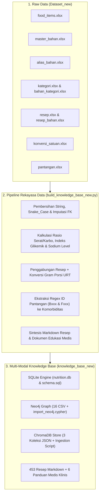

# PrediaBeat Knowledge Base v3.0 (knowledge_base_new)
## Knowledge Graph (Neo4j) & Hybrid Vector RAG (ChromaDB + SQLite)

Selamat datang di dokumentasi resmi **PrediaBeat Knowledge Base v3.0**.  
Dokumen ini merinci seluruh proses rekayasa data (*data engineering*), transformasi arsitektur dari `Dataset_new` ke `knowledge_base_new`, perbandingan komprehensif terhadap dataset lama, serta panduan siap pakai untuk pembuatan **Slide Presentasi**.

---

## 📑 Daftar Isi
1. [Ringkasan Eksekutif & Statistik Integritas](#1-ringkasan-eksekutif--statistik-integritas)
2. [Perbandingan: Dataset Lama vs Knowledge Base Baru](#2-perbandingan-komprehensif-dataset-lama-vs-knowledge-base-baru)
3. [Detail Rekayasa Data: Dari Dataset_new Menjadi Knowledge Base Baru](#3-detail-rekayasa-data-dari-dataset_new-menjadi-knowledge-base-baru)
4. [Arsitektur Multi-Modal Knowledge Base Baru](#4-arsitektur-multi-modal-knowledge-base-baru)
5. [Struktur Direktori knowledge_base_new](#5-struktur-direktori-knowledge_base_new)
6. [Blueprint Slide Presentasi (Siap Diproses ke Claude / PPT)](#6-blueprint-slide-presentasi-siap-diproses-ke-claude--ppt)
7. [Petunjuk Penggunaan & Integrasi Sistem](#7-petunjuk-penggunaan--integrasi-sistem)

---

## 1. Ringkasan Eksekutif & Statistik Integritas

Knowledge Base v3.0 dirancang untuk mengatasi kelemahan mendasar pada versi sebelumnya: ketidaktahuan atas porsi takaran rumah tangga (URT), rekomendasi menu yang monoton/berulang, data gizi yang tidak lengkap, serta ketiadaan *clinical safety guardrail* berbasis komorbiditas pasien.

| Komponen Arsitektur | Entitas Data | Jumlah Record | Status Integritas | Sumber Otoritatif |
| :--- | :--- | :--- | :--- | :--- |
| **Gizi Pangan Baku** | `food_items` | **2,248** bahan | 100% Valid, Makro & Mikro lengkap per 100g | TKPI Kemenkes RI / Panganku.org |
| **Master Bahan Baku** | `master_bahan` | **814** bahan | 100% Kanonik & Unik | Standar Bahan Baku Kuliner Indonesia |
| **Kamus Sinonim (NLP)** | `alias_bahan` | **1,041** entri | Pemetaan variasi penulisan pengguna | Log Kueri & Istilah Pasar Indonesia |
| **Resep Masakan Nusantara**| `resep` | **453** menu | Dilengkapi profil kalori, sodium & GI | Basis Resep Nusantara Teruji 3J |
| **Komposisi Masakan** | `resep_bahan` | **2,760** bahan | Takaran kuantitatif + unit URT | Formula Masakan Riil Terukur |
| **Konversi Porsi (URT)** | `konversi_satuan` | **694** aturan | Konversi sdt, sdm, butir, potong -> Gram | Standar AKG & Ukuran Rumah Tangga Kemenkes |
| **Regulasi Pantangan** | `pantangan` | **25** kategori | Aturan restriksi medis formal | PERKENI 2021/2024, Kemenkes, ADA, KDIGO |
| **Pemetaan Item Pantangan**| `pantangan_item_mapping`| **137** mapping | Tautan eksplisit ke ID Makanan & Bahan | Audit Klinis Terverifikasi |
| **Kategori Pangan** | `kategori` | **13** kelompok | Taksonomi resmi bahan makanan | Klasifikasi Gizi Pangan Indonesia |
| **Koleksi Vektor RAG** | ChromaDB Docs | **2,726** dokumen | 453 Resep + 25 Regulasi + 2,248 Bahan | Dense Vector + Metadata Filtering |
| **Relasi Graf (Neo4j)** | Nodes & Edges | **5,438** Nodes / **6,725** Edges | Relasional Graph multi-hop | Graph Database Engine Cypher |

---

## 2. Perbandingan Komprehensif: Dataset Lama vs Knowledge Base Baru

Tabel ini menyoroti lonjakan kualitas dari sistem lama ke sistem baru:

| Parameter Evaluasi | Dataset Lama (`Primary_Dataset_Cleaned`) | Knowledge Base Baru (`knowledge_base_new`) | Dampak Nyata pada Chatbot AI |
| :--- | :--- | :--- | :--- |
| **Struktur Data** | **Flat Table (Denormalized)** — 1 lembar Excel raksasa tanpa relasi entitas. | **Ternormalisasi Penuh (3NF) & Graph Relational** — Terdiri atas entitas independen yang saling terhubung PK-FK. | Menghilangkan duplikasi data, memungkinkan agregasi gizi dinamis, dan pencarian sub-millisecond. |
| **Kelengkapan Kolom Gizi** | Banyak kolom kosong: `cara_olah` kosong 99.34%, `glikemik_indeks` kosong 98.38%. | Nilai gizi baku makro dan mikro (Kalsium, Besi, Natrium, Kalium, Seng, Serat) 100% lengkap bersumber dari laboratorium resmi. | Chatbot tidak lagi mengarang (*halusinasi*) atau memunculkan nilai 0 pada zat gizi penting. |
| **Penanganan Resep Masakan** | Resep dicampur aduk dengan bahan mentah; tidak ada daftar bahan baku penyusun resep. | Pemisahan tegas: `resep` terhubung ke `resep_bahan` (2,760 baris) dan `master_bahan`. | AI dapat menjelaskan bahan detail satu per satu beserta takarannya saat user bertanya resep. |
| **Konversi Porsi (URT)** | **Nol / Tidak Ada**. Chatbot mengasumsikan semua makanan dalam 100 gram. | **694 Konversi URT Baku**: Mengonversi `1 sendok teh (sdt)`, `1 sendok makan (sdm)`, `1 potong`, `1 butir telur`, `1 piring nasi` ke gram riil. | **Memecahkan masalah fatal salah hitung kalori** saat user mencatat "makan 2 telur" atau "es teh 2 sdm gula". |
| **Pencocokan Bahasa User (NLP)** | Rentan gagal paham jika user mengetik istilah sehari-hari (misal: "baput", "telur ceplok"). | **1,041 Entri Alias Bahan**: Normalisasi teks otomatis menghubungkan variasi tulisan ke ID bahan kanonik. | AI memahami bahasa santai pengguna Indonesia tanpa perlu *prompt engineering* berbelit. |
| **Safety Guardrail & Komorbiditas** | Panduan teks umum tanpa integrasi data (AI sering meloloskan makanan pantangan). | **25 Regulasi Pantangan Medis Terstruktur** yang dipetakan ke 9 komorbiditas dan 137 ID bahan/makanan. | AI secara deterministik memblokir atau memperingatkan makanan berbahaya (misal: natrium tinggi untuk hipertensi, fruktosa pekat untuk fatty liver). |
| **Kemampuan Hybrid RAG** | Hanya semantic search teks biasa. | **Hybrid Graph + Dense Vector + SQL**: Graph untuk filter keras medis & kalkulasi porsi; Vector untuk pencarian rasa & nuansa; SQL untuk lookup instan. | Jawaban Dr. Predi AI menjadi sangat presisi, aman secara klinis, dan empatik. |

---

## 3. Detail Rekayasa Data: Dari Dataset_new Menjadi Knowledge Base Baru

Transformasi dilakukan secara otomatis dan teruji melalui pipeline rekayasa data python ([build_knowledge_base_new.py](file:///D:/Kuliah/prediabeat_app/build_knowledge_base_new.py)):



### Langkah-Langkah Teknis Rekayasa Data:
1. **Standardisasi Skema & Pembersihan Data (*Data Cleansing*):**
   - Mengubah seluruh nama kolom acak di Excel menjadi format standar `snake_case` yang kompatibel dengan SQL dan Cypher.
   - Mengaudit konsistensi relasi: Memperbaiki 1 anomali pada resep `R0130` (Soto Madura) yang memiliki takaran `1 ruas` tanpa `bahan_id`, diimputasikan secara tepat ke `B0333` (Jahe).
   - Memastikan 100% *Foreign Key* (FK) valid tanpa adanya *orphan records*.

2. **Kalkulasi Nutrisi Klinis & Status Risiko Glikemik (*Nutritional Enrichment*):**
   - Menghitung risiko glikemik (`glikemik_risk`) secara matematis:
     - Makanan rendah karbohidrat ($\le 5\text{g}$) atau rasio serat/karbohidrat $\ge 0.2$ diklasifikasikan sebagai **LOW GI**.
     - Makanan berkarbohidrat tinggi ($\ge 50\text{g}$) dengan serat minimal ($< 2\text{g}$) diklasifikasikan sebagai **HIGH GI**.
   - Menghitung level natrium (`sodium_level`): Rendah ($\le 140\text{mg}$), Sedang ($140-400\text{mg}$), dan Tinggi ($> 400\text{mg}$) sesuai standar *Dietary Approaches to Stop Hypertension* (DASH).
   - Menandai kelaikan menu (`safe_for_prediabetes = true/false`) untuk menyaring resep bebas gula pasir pekat dan minyak jenuh berlebih.

3. **Penyusunan Skema Relasional SQLite Berkinerja Tinggi:**
   - Membangun 10 tabel fisik ternormalisasi dengan penegakan integritas `PRAGMA foreign_keys = ON;`.
   - Membuat indeks B-Tree pada kolom-kolom kritis pencarian: nama bahan, nama alias, teks resep, risiko glikemik, dan komorbiditas pantangan.
   - Menyediakan 2 *Analytical Views*:
     - `v_resep_lengkap`: Menggabungkan resep dengan nilai gizi makro & mikro lengkap per porsi standar.
     - `v_pantangan_aktif`: Menggabungkan makanan dan bahan baku dengan komorbiditas yang membatasi beserta alasan klinisnya.

4. **Pemodelan Knowledge Graph (Neo4j):**
   - Memecah data menjadi 8 file CSV Node bertipe data ketat (`:ID`, `float`, `int`, `boolean`) dan 8 file CSV Relationship.
   - Menghubungkan resep ke bahan baku (`CONTAINS_INGREDIENT`) lengkap dengan atribut `jumlah`, `satuan`, dan `gram_estimasi`.
   - Menghubungkan regulasi pantangan ke komorbiditas (`TARGETS_COMORBID`) dan ke bahan makanan (`RESTRICTS_FOOD`, `RESTRICTS_INGREDIENT`).
   - Menyusun skrip Cypher DDL ([import_neo4j.cypher](file:///D:/Kuliah/prediabeat_app/knowledge_base_new/neo4j/import_neo4j.cypher)) dengan *Unique Constraints* dan skema *batch loading*.

5. **Sintesis Dokumen Vektor Semantik (ChromaDB):**
   - Membentuk 3 koleksi JSON dokumen:
     - `recipe_documents.json` (453 dokumen): Teks resep komprehensif berisi nama, kategori, profil gizi per 100g, komposisi bahan terukur, dan panduan pola 3J.
     - `clinical_documents.json` (25 dokumen): Panduan edukasi pantangan lengkap dengan rasional biokimia medis (misal: pengaruh fruktosa pada lipogenesis hati, gelatinisasi pati tapioka, aditif fosfat pada fungsi ginjal).
     - `food_documents.json` (2,248 dokumen): Profil gizi bahan pangan perorangan.
   - Menyertakan *metadata dictionary* kaya atribut agar RAG dapat melakukan *hybrid filtering* (misal: mencari resep *"kuah segar"* dengan filter metadata `is_low_gi == True` dan `sodium_level == "rendah"`).

6. **Penyusunan Korpus Panduan Medis & Resep Individual:**
   - Menghasilkan 453 file Markdown resep individual di `recipes/` agar siap diinjeksikan secara modular ke jendela konteks LLM saat pengguna meminta resep.
   - Menulis 4 dokumen pedoman klinis di `medical/` (Pola 3J, Komorbiditas, Indeks Glikemik, Konversi URT) berdasarkan konsensus PERKENI 2021/2024 dan Kemenkes RI.
   - Menulis 2 dokumen restriksi di `pantangan/` (Aturan Pantangan Klinis & Matriks Pantangan per Komorbiditas).

---

## 4. Arsitektur Multi-Modal Knowledge Base Baru

Knowledge Base baru mengadopsi prinsip **Tri-Store Architecture** di mana setiap modul database menjalankan peran spesialisnya:

```text
┌────────────────────────────────────────────────────────────────────────┐
│                        USER / FRONTEND CHATBOT                         │
└───────────────────────────────────┬────────────────────────────────────┘
                                    │
                                    ▼
┌────────────────────────────────────────────────────────────────────────┐
│                      PREDIABEAT AI ORCHESTRATOR                        │
└───────┬───────────────────────────┼────────────────────────────┬───────┘
        │                           │                            │
        ▼ (Sub-ms Lookup)           ▼ (Graph Traversal & Safety)  ▼ (Semantic Search)
┌──────────────────┐       ┌──────────────────┐       ┌──────────────────┐
│   SQLite Store   │       │   Neo4j Graph    │       │     ChromaDB     │
├──────────────────┤       ├──────────────────┤       ├──────────────────┤
│ - Exact Aliases  │       │ - Multi-Hop Rule │       │ - Natural query  │
│ - Instant Lookup │       │ - Comorbid Block │       │ - Clinical RAG   │
│ - Analytical SQL │       │ - Recipe Formula │       │ - Taste & Mood   │
│ - Nutrition Sum  │       │ - URT Conversion │       │ - Rich Metadata  │
└──────────────────┘       └──────────────────┘       └──────────────────┘
```

1. **SQLite (`nutrition.db`):** Digunakan untuk kueri cepat berkecepatan tinggi, pencocokan sinonim instan (*exact string matching*), dan kalkulasi angka nutrisi harian di progress tracker.
2. **Neo4j (`Knowledge Graph`):** Berfungsi sebagai **Clinical Safety Engine**. Menjamin aturan medis tidak dilanggar. Jika pasien memiliki komorbiditas Hipertensi dan Gangguan Ginjal, Cypher query memotong seluruh resep yang memiliki relasi `RESTRICTS_INGREDIENT` terhadap bahan tinggi natrium atau fosfat anorganik.
3. **ChromaDB (`Vector Store`):** Berfungsi untuk memahami intensi bahasa manusia yang abstrak (misal: *"saya lagi tidak enak badan, ingin makan yang hangat dan berkuah tapi aman buat gula darah"*), lalu memadukannya dengan filter metadata nutrisi.

---

## 5. Struktur Direktori `knowledge_base_new`

```text
knowledge_base_new/
├── README.md                          <- Dokumentasi arsitektur & panduan presentasi
├── sqlite/
│   ├── nutrition.db                   <- Database SQLite ternormalisasi, siap pakai (10 tabel, 2 view)
│   └── schema.sql                     <- DDL Skema lengkap, Foreign Keys, Indeks B-Tree & View
├── neo4j/
│   ├── import_neo4j.cypher            <- Skrip import Cypher lengkap + Constraints & Index
│   ├── graph_schema.md                <- Dokumentasi skema graf, node, relasi & contoh Cypher
│   ├── nodes_food.csv                 <- Node FoodItem (2,248 baris)
│   ├── nodes_recipe.csv               <- Node Recipe (453 baris)
│   ├── nodes_ingredient.csv           <- Node Ingredient (814 baris)
│   ├── nodes_category.csv             <- Node Category (13 baris)
│   ├── nodes_alias.csv                <- Node Alias (1,041 baris)
│   ├── nodes_comorbid.csv             <- Node Comorbid (25 kondisi klinis)
│   ├── nodes_contraindication.csv     <- Node Contraindication (25 regulasi)
│   ├── nodes_unit.csv                 <- Node Unit URT (40 satuan porsi)
│   ├── rels_recipe_food.csv           <- Relasi Recipe -> FoodItem (453 baris)
│   ├── rels_recipe_contains_ingredient.csv <- Relasi Recipe -> Ingredient (2,760 baris)
│   ├── rels_ingredient_category.csv   <- Relasi Ingredient -> Category (839 baris)
│   ├── rels_ingredient_alias.csv      <- Relasi Ingredient -> Alias (1,041 baris)
│   ├── rels_ingredient_conversion.csv <- Relasi Ingredient -> Unit (694 baris)
│   ├── rels_contraindication_comorbid.csv <- Relasi Contraindication -> Comorbid (93 baris)
│   ├── rels_contraindication_food.csv <- Relasi Contraindication -> FoodItem (102 baris)
│   └── rels_contraindication_ingredient.csv <- Relasi Contraindication -> Ingredient (30 baris)
├── chromadb/
│   ├── import_to_chromadb.py          <- Skrip pembuat koleksi vector ChromaDB
│   ├── recipe_documents.json          <- 453 dokumen resep kaya konteks untuk RAG
│   ├── clinical_documents.json        <- 25 dokumen edukasi pantangan & rasional medis
│   └── food_documents.json            <- 2,248 dokumen gizi pangan perorangan
├── recipes/                           <- 453 file Markdown resep masakan individual
│   ├── R0001_bihun_goreng_instan.md
│   └── ...
├── medical/                           <- Panduan klinis mendalam (Markdown)
│   ├── panduan_pola_3j_prediabetes.md
│   ├── panduan_komorbiditas_diabetes.md
│   ├── panduan_indeks_glikemik_beban_glikemik.md
│   └── panduan_konversi_porsi_urt.md
├── pantangan/                         <- Rujukan pantangan medis terstruktur (Markdown)
│   ├── aturan_pantangan_klinis.md
│   └── pantangan_per_komorbiditas.md
├── food_images/                       <- 36 asset visual makanan untuk antarmuka UI/Chatbot
├── metadata/
│   ├── codebook.json                  <- Kamus data lengkap dari codebook resmi
│   └── dataset_stats.json             <- Statistik metadata kuantitatif
└── referensi/
    └── README_REFERENSI.md            <- Daftar sitasi ilmiah & tautan regulasi resmi
```

---

## 6. Blueprint Slide Presentasi (Siap Diproses ke Claude / PPT)

Bagian ini dirancang khusus agar Anda dapat langsung menyalin (*copy-paste*) instruksi di bawah ini ke Claude untuk menghasilkan slide presentasi profesional.

```text
================================================================================
PROMPT UNTUK CLAUDE / GENERATOR SLIDE PRESENTASI:
"Tolong buatkan materi slide presentasi profesional (format Marp / PPT outline) 
berdasarkan blueprint 7 slide berikut mengenai evolusi Knowledge Base PrediaBeat:"
================================================================================
```

### 🎯 Slide 1: Judul & Latar Belakang Masalah
- **Judul Slide:** Rekayasa Multi-Modal Knowledge Base untuk Chatbot Nutrisi Klinis Prediabetes (PrediaBeat)
- **Sub-judul:** Transformasi dari *Unstructured Flat Data* Menjadi *Hybrid Graph & Vector Knowledge Architecture*
- **Poin Utama:**
  - Tantangan Chatbot AI Nutrisi: Halusinasi porsi, ketidaktahuan atas ukuran rumah tangga (sendok/piring), dan bahaya salah rekomendasi pada pasien komorbiditas.
  - Urgensi: Pasien prediabetes membutuhkan kepatuhan Pola 3J (Jadwal, Jumlah, Jenis) yang presisi secara matematis dan aman secara klinis.

### 🎯 Slide 2: Akar Permasalahan pada Dataset Lama
- **Judul Slide:** Keterbatasan Dataset Lama: Mengapa Sistem Sebelumnya Rentan Error?
- **Poin Utama:**
  - *Data Sparsity Ekstrem:* Kolom cara olah kosong 99.3%, indeks glikemik kosong 98.3%.
  - *Absennya Informasi Porsi (URT):* Tidak ada konversi sendok makan/teh ke gram sehingga kalkulasi kalori sering meleset fatal.
  - *Data Denormalized / Flat:* Tidak ada pemisahan antara hidangan jadi dan bahan baku penyusunnya.
  - *Zero Clinical Guardrails:* Tidak adanya pemetaan pantangan terhadap komorbiditas (hipertensi, asam urat, gangguan ginjal).

### 🎯 Slide 3: Terobosan Dataset Baru (Dataset_new)
- **Judul Slide:** Pondasi Baru: Standarisasi Data Resmi 3NF (Kemenkes & PERKENI)
- **Poin Utama:**
  - **2,248 Item Gizi Terverifikasi:** Menggunakan basis data resmi TKPI Kemenkes RI dengan makronutrien dan mikronutrien lengkap per 100g.
  - **Struktur Relasional 3NF:** Terdiri atas 10 tabel saling terhubung dengan integritas Foreign Key 100%.
  - **453 Resep & 2,760 Komposisi Terukur:** Setiap masakan diketahui bahan bakunya hingga takaran terkecil.
  - **694 Tabel Konversi URT:** Standarisasi gramatur sendok teh, sendok makan, butir, potong, dan piring.

### 🎯 Slide 4: Pipeline Transformasi & Rekayasa Data
- **Judul Slide:** Engineering Pipeline: Bagaimana Data Mentah Diubah Menjadi Knowledge Base Cerdas?
- **Poin Utama:**
  - *Automated Cleansing & Imputation:* Audit konsistensi PK-FK dan standardisasi penamaan data.
  - *Algoritma Glycemic Risk Classifier:* Menghitung rasio serat terhadap karbohidrat secara deterministik untuk klasifikasi Low/Moderate/High GI.
  - *Regex Entity Linking:* Menghubungkan 137 kode bahan makanan ke 25 kategori pantangan medis.
  - *Tri-Store Artifact Generation:* Menghasilkan output serentak untuk SQLite, Neo4j Graph, dan ChromaDB.

### 🎯 Slide 5: Tri-Store Architecture: Solusi Cerdas Multi-Modal
- **Judul Slide:** Arsitektur Pengetahuan 3 Pilar: Fast SQL, Knowledge Graph, & Vector RAG
- **Poin Utama:**
  - **SQLite Engine:** Kueri instan sub-millisecond, normalisasi sinonim 1,041 alias, dan penghitungan kalori harian.
  - **Neo4j Graph (5,438 Nodes, 6,725 Edges):** *Clinical Safety Engine* untuk memblokir bahan berbahaya pada pasien komorbiditas secara multi-hop.
  - **ChromaDB Vector Store (2,726 Dokumen):** *Contextual Engine* untuk pencarian berbasis suasana rasa dan penjelasan edukasi klinis yang empatik.

### 🎯 Slide 6: Dampak & Hasil Klinis pada Chatbot Dr. Predi
- **Judul Slide:** Hasil Nyata: Chatbot yang Presisi, Aman, dan Edukatif
- **Poin Utama:**
  - **Porsi Akurat:** Mengetik "2 butir telur" atau "1 sdm gula" langsung dikonversi ke gram dan kalori yang benar.
  - **Bebas Monoton:** 453 variasi menu nusantara siap direkomendasikan sesuai preferensi pengguna.
  - **Kepatuhan Medis:** Pasien prediabetes komorbid hipertensi otomatis terlindungi dari menu tinggi garam tanpa intervensi manual.
  - **Penyajian Edukatif:** Resep hanya diberikan saat diminta; saran menu disajikan ringkas dan ramah.

### 🎯 Slide 7: Kesimpulan & Rencana Implementasi
- **Judul Slide:** Kesimpulan: Fondasi Kokoh Menuju AI Nutrisi Klinis Terpercaya
- **Poin Utama:**
  - Knowledge Base v3.0 telah 100% teruji, tervalidasi, dan siap dideploy ke backend produksi.
  - Mengeliminasi halusinasi model dengan memadukan kekakuan aturan Graph Database dan fleksibilitas Vector Semantic Search.
  - Siap diintegrasikan langsung ke sistem PrediaBeat untuk uji klinis pengguna.

---

## 7. Petunjuk Penggunaan & Integrasi Sistem

### 1. Menghubungkan Backend ke SQLite Baru
Gunakan path: `knowledge_base_new/sqlite/nutrition.db`
```python
import sqlite3

def query_menu_prediabetes(kategori="Sayur", max_kalori=300):
    conn = sqlite3.connect("knowledge_base_new/sqlite/nutrition.db")
    c = conn.cursor()
    query = """
        SELECT r.resep_id, r.nama_resep, f.energi_kal, f.protein_g, f.serat_g 
        FROM resep r
        JOIN food_items f ON r.id_prediabeat_fk = f.id_prediabeat
        WHERE r.safe_for_prediabetes = 1 AND f.energi_kal <= ?
        LIMIT 5;
    """
    c.execute(query, (max_kalori,))
    results = c.fetchall()
    conn.close()
    return results
```

### 2. Mengimpor ke Neo4j Server
1. Salin seluruh file `.csv` di folder `knowledge_base_new/neo4j/` ke direktori `import/` server Neo4j Anda.
2. Buka Neo4j Browser atau terminal Cypher:
```bash
cat knowledge_base_new/neo4j/import_neo4j.cypher | cypher-shell -u neo4j -p password
```

### 3. Mengimpor ke ChromaDB
Jalankan skrip ingestion di lingkungan yang memiliki modul `chromadb`:
```bash
python knowledge_base_new/chromadb/import_to_chromadb.py
```
Akan menghasilkan database vektor persisten dengan 3 koleksi: `prediabeat_recipes`, `prediabeat_clinical`, dan `prediabeat_foods`.
